# Valzaya — Entity Relationship Diagram (Phase 1)

Source of truth: `supabase/migrations/`. Money columns are `bigint` fils (1 AED = 100 fils).
Every table has RLS enabled (see the policy summary below).

```mermaid
erDiagram
    AUTH_USERS ||--o| CUSTOMERS : "profile (id)"
    AUTH_USERS ||--o| STAFF_MEMBERS : "staff role"

    CUSTOMERS ||--o{ ADDRESSES : has
    CUSTOMERS ||--o{ CONSENTS : gives
    CUSTOMERS ||--o{ WAITLIST_SIGNUPS : joins
    CUSTOMERS ||--o{ CARTS : owns
    CUSTOMERS ||--o{ ORDERS : places
    CUSTOMERS ||--o{ RETURNS : opens
    CUSTOMERS ||--o{ MEASUREMENTS : "MTO profiles"

    PRODUCTS ||--|{ PRODUCT_VARIANTS : has
    PRODUCTS ||--o{ PRODUCT_MEDIA : shows
    PRODUCT_VARIANTS ||--o{ PRODUCT_MEDIA : "colour-specific"
    PRODUCT_VARIANTS ||--o{ INVENTORY_LEVELS : "stock per location"
    PRODUCT_VARIANTS ||--o{ INVENTORY_MOVEMENTS : ledger
    PRODUCT_VARIANTS ||--o{ DROP_ITEMS : "in drop"
    PRODUCT_VARIANTS ||--o{ CART_ITEMS : "in cart"
    PRODUCT_VARIANTS ||--o{ ORDER_ITEMS : "sold as"

    DROPS ||--o{ DROP_ITEMS : contains
    DROPS ||--o{ WAITLIST_SIGNUPS : "waitlist for"
    DROPS ||--o{ ORDERS : "sold in"
    CONSENTS ||--o{ WAITLIST_SIGNUPS : "consent for"

    CARTS ||--o{ CART_ITEMS : contains
    CARTS ||--o| ORDERS : "converted to"

    ORDERS ||--|{ ORDER_ITEMS : "line snapshot"
    ORDERS ||--|{ ORDER_EVENTS : "status history"
    ORDERS ||--o{ PAYMENTS : "paid by"
    ORDERS ||--o{ REFUNDS : refunded
    ORDERS ||--o{ SHIPMENTS : "fulfilled by"
    ORDERS ||--o{ RETURNS : "returned via"
    PAYMENTS ||--o{ REFUNDS : "refunded from"
    ALLOWED_ORDER_TRANSITIONS }o--o{ ORDER_EVENTS : "validates (by status)"

    STAFF_MEMBERS {
        uuid user_id PK
        staff_role role "owner | ops"
        text display_name
        bool active
    }
    CUSTOMERS {
        uuid id PK "= auth.users.id"
        citext email
        text phone "E.164"
        text preferred_locale "en | ar"
    }
    ADDRESSES {
        uuid id PK
        uuid customer_id FK
        char country_code
        uae_emirate emirate "required iff AE"
        text city
        text line1
        bool is_default_shipping
    }
    CONSENTS {
        uuid id PK
        uuid customer_id FK "nullable"
        consent_channel channel "marketing_email | marketing_whatsapp"
        bool granted
        text policy_version
        timestamptz captured_at
    }
    PRODUCTS {
        uuid id PK
        text slug UK
        text style_code UK "SKU style"
        text name_en
        text name_ar
        text fabric
        product_status status "draft | active | archived"
    }
    PRODUCT_VARIANTS {
        uuid id PK
        uuid product_id FK
        text sku UK "VZ-style-colour-size"
        text barcode UK
        text size
        text colour_code
        bigint price_fils "VAT-inclusive"
        stock_mode stock_mode "stock | preorder | mto"
        date preorder_ship_date
        bool active
    }
    PRODUCT_MEDIA {
        uuid id PK
        uuid product_id FK
        uuid variant_id FK
        text storage_path UK "bucket product-media"
        text alt_en
        text alt_ar
    }
    DROPS {
        uuid id PK
        int number UK
        text title_en
        text title_ar
        timestamptz early_access_at
        timestamptz opens_at
        timestamptz closes_at
        int unit_cap
        drop_status status
    }
    DROP_ITEMS {
        uuid drop_id PK, FK
        uuid variant_id PK, FK
        int unit_cap "optional per-variant"
    }
    INVENTORY_LEVELS {
        uuid variant_id PK, FK
        inventory_location location PK "warehouse | studio"
        int on_hand
        int reserved
        int available "generated"
        inventory_source updated_from "manual | 3pl_sync"
    }
    INVENTORY_MOVEMENTS {
        bigint id PK
        uuid variant_id FK
        inventory_location location
        int delta_on_hand
        int delta_reserved
        inventory_reason reason
    }
    WAITLIST_SIGNUPS {
        uuid id PK
        citext email
        text phone
        uuid drop_id FK "nullable"
        uuid consent_id FK
        text source
    }
    CARTS {
        uuid id PK
        uuid customer_id FK "null for guest"
        text guest_token_hash UK "sha256"
        cart_status status
    }
    CART_ITEMS {
        uuid id PK
        uuid cart_id FK
        uuid variant_id FK
        int quantity
    }
    ORDERS {
        uuid id PK
        text order_number UK "VZ-000001"
        uuid customer_id FK
        citext email
        order_status status
        bigint subtotal_net_fils
        bigint vat_fils
        bigint total_fils "= net + vat"
        bigint shipping_fils "incl. in total"
        payment_provider payment_method
        date delivery_promise_date
        jsonb shipping_address "snapshot"
    }
    ORDER_ITEMS {
        uuid id PK
        uuid order_id FK
        text sku
        text product_name_en
        text product_name_ar
        text size
        int quantity
        bigint unit_price_fils
        bigint line_net_fils
        bigint line_vat_fils
        bigint line_total_fils
    }
    ORDER_EVENTS {
        bigint id PK
        uuid order_id FK
        order_status from_status
        order_status to_status
        text actor_type
    }
    ALLOWED_ORDER_TRANSITIONS {
        order_status from_status PK
        order_status to_status PK
    }
    PAYMENTS {
        uuid id PK
        uuid order_id FK
        payment_provider provider "card | tabby | tamara"
        text provider_ref
        payment_status status
        bigint amount_fils
        text raw_ref
    }
    REFUNDS {
        uuid id PK
        uuid payment_id FK
        uuid order_id FK
        bigint amount_fils
        refund_status status
    }
    SHIPMENTS {
        uuid id PK
        uuid order_id FK
        text provider
        text provider_order_ref
        text tracking_no
        text carrier
        shipment_status status
        jsonb events
    }
    RETURNS {
        uuid id PK
        text rma_no UK "RMA-000001"
        uuid order_id FK
        return_type type "refund | exchange"
        return_status status
        jsonb items
    }
    MEASUREMENTS {
        uuid id PK
        uuid customer_id FK
        jsonb profile
        timestamptz taken_at
    }
    WEBHOOK_EVENTS {
        bigint id PK
        text provider "UK with event_id"
        text event_id
        bool signature_ok
        jsonb payload
        timestamptz processed_at
        text error
    }
    INTEGRATION_SYNC_RUNS {
        bigint id PK
        text provider
        text kind
        timestamptz started_at
        timestamptz finished_at
        jsonb counts
        text error
    }
    AUDIT_LOG {
        bigint id PK
        text actor_type
        uuid actor_user_id
        text action
        text entity_type
        text entity_id
        jsonb before
        jsonb after
    }
    SETTINGS {
        text key PK
        jsonb value
        bool is_public
    }
```

## RLS summary

| Table | anon | customer (own rows) | ops | owner | service role |
|---|---|---|---|---|---|
| products, product_variants, product_media | read active | read active | read all, write | all | all |
| drops, drop_items | read non-draft | read non-draft | read all, write | all | all |
| customers | — | read/update own (name, phone, locale) | read | read/update | all |
| addresses, carts, cart_items, measurements | — | read/write own | read (+ write measurements) | read | all |
| consents | — | read own, insert own (append-only) | read | read | all |
| waitlist_signups | — (server inserts) | read/insert/delete own | read | read | all |
| orders | — | read own | read, edit fulfilment fields | same as ops | all |
| order_items, order_events, payments | — | read own | read | read | all |
| refunds | — | read own | read | read, request | all |
| shipments | — | read own | read/write | read/write | all |
| returns | — | read own, open on own order | read/update | read/update | all |
| inventory_levels, inventory_movements | — | — | read, insert manual movements | same | all |
| allowed_order_transitions, integration_sync_runs | — | — | read | read | all |
| webhook_events | — | — | — | read | all |
| audit_log | — | — | — | read | all (append-only) |
| settings | read `is_public` | read `is_public` | read `is_public` | all | all |
| staff_members | — | read self | read self | all | all |

Order `status` can only change through `public.apply_order_transition()` (service role or
ops/owner), which validates against `allowed_order_transitions` and writes `order_events` +
`audit_log`. A trigger rejects any other status update.
